  

  <strong>Desarrollador web junior · Cádiz, España</strong> 
  Aplicaciones web, resolución de problemas y aprendizaje práctico.

  <a href="#proyectos">Proyectos</a> &nbsp; / &nbsp;
  <a href="#tecnologías">Tecnologías</a> &nbsp; / &nbsp;
  <a href="https://next-gen-api-one.vercel.app/es/">Demo de NextGen</a>

### Sobre mí

Soy **Miguel**, Técnico Superior en Desarrollo de Aplicaciones Web. He realizado prácticas de desarrollo frontend con **Vue.js y TypeScript** y cuento con más de tres años de experiencia en **soporte técnico, resolución de incidencias y atención a usuarios**.

Busco mi primera oportunidad laboral en desarrollo **frontend, backend o full stack**, en remoto desde España o en la zona de Cádiz. También estoy ampliando mi formación en sistemas, cloud y ciberseguridad.

### Proyectos

#### 01 / NextGen IT Services
**Desarrollo web · Proyecto académico de DAW**

Aplicación bilingüe con formulario de contacto y panel privado para gestionar solicitudes.

- Interfaz responsive en español e inglés con **Astro, TypeScript y Tailwind CSS**.
- Persistencia con **Prisma y PostgreSQL**.
- Autenticación, búsqueda, filtros y cambios de estado desde el panel de administración.
- Pruebas unitarias y comprobaciones automáticas con GitHub Actions.

**[Ver código →](https://github.com/Pumcheese/NextGenApi) · [Probar demo →](https://next-gen-api-one.vercel.app/es/)**

La demo utiliza contenido de ejemplo. Introduce únicamente datos ficticios; el acceso de administración es privado.

---

#### 02 / Mini SOC
**Ciberseguridad · Proyecto de aprendizaje**

Herramienta local para analizar registros de acceso, detectar patrones de fallos e investigar alertas.

- Importación de registros **CSV** y reglas de detección por cuenta y ventana de tiempo.
- Investigación de accesos e IP, prioridades y seguimiento de casos.
- Notas, veredictos e informes exportables en Markdown.
- **Python, SQLite y JavaScript**, con pruebas automatizadas.

**[Ver código e instrucciones →](https://github.com/Pumcheese/mini-soc)**

Proyecto de aprendizaje con datos ficticios. La aplicación se ejecuta en local.

### Tecnologías

  

| Área | Tecnologías |
| --- | --- |
| Frontend | Vue.js, TypeScript, JavaScript, HTML, CSS, Astro, Tailwind CSS |
| Backend y datos | Endpoints HTTP con Astro, Prisma, PostgreSQL, Python, SQLite |
| Herramientas | Git, GitHub, Docker, Vercel |
| En formación | Linux, Microsoft Azure, análisis de registros y ciberseguridad |

### Ahora

Estoy construyendo proyectos que me permitan **conectar desarrollo y seguridad**: profundizar en backend y bases de datos, mejorar mis aplicaciones con Vue.js y TypeScript y practicar la investigación de alertas con mi Mini SOC.

Cádiz, España · Abierto a oportunidades de desarrollo junior

